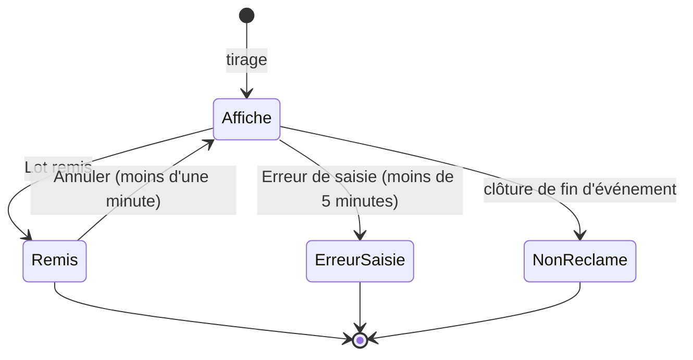

# Note de conception — Tombola

**Statut :** décisions actées avec Simon avant tout développement. Le lot 1
(données, saisie des tirages, remise des lots, page bénévole) est livré ; le
lot 2 (affichage public et statistiques) s'appuie sur cette note.

À lire avec `docs/specification.md` §2 (« ne jamais bloquer ») et §9.1
(aucune donnée personnelle), `docs/conception-journal.md` (vocabulaire fermé)
et `docs/protocole-stress-test.md` (écritures concurrentes).

---

## 1. Le besoin

Pendant l'événement, une tombola tire environ cinq numéros gagnants par heure.
Les visiteurs viennent chercher leur lot au fil de la journée. Il faut :

- **afficher** les numéros gagnants encore en attente, là où le public les
  voit (écran de salle, page d'accueil, page publique) ;
- **retirer** un numéro de l'affichage quand son lot est remis ;
- **garder un historique** : numéros sortis, heure d'affichage, heure de
  remise, donc le délai entre les deux.

## 2. Décisions actées

1. **Un module désactivable « Tombola »**, avec les quatre états habituels
   (`app/modules.py`), **désactivé par défaut**. Une base existante ne voit
   rien changer.
2. **Numéros** : uniquement des entiers de **1 à 9999**.
3. **Deux façons de saisir un tirage**, sur la même page bénévole :
   - la **saisie manuelle** de 1 à 5 numéros tirés à la main, le cas normal ;
   - le **tirage par l'application**, en secours : on indique le plus grand
     numéro vendu, l'application tire 5 numéros au hasard parmi ceux de 1 à ce
     maximum qui ne sont pas déjà sortis pendant l'édition. Le tirage est
     **enregistré et affiché dès l'appui**. Il n'existe **aucun bouton pour le
     reprendre** : pouvoir refaire un tirage, c'est pouvoir choisir les
     gagnants.
4. **Tous les bénévoles** saisissent les tirages et remettent les lots.
5. **Remise d'un lot** : par le numéro présenté (un champ, puis **Lot
   remis**) ou par un bouton sur chaque numéro en attente. Une remise peut
   être **annulée pendant une minute** : le numéro revient à l'affichage.
6. **Édition** : la **clôture de fin d'événement termine la tombola**. Les
   numéros encore en attente passent en « non réclamé ». **Le premier tirage
   qui suit ouvre une nouvelle édition** : les numéros de l'année précédente
   peuvent ressortir, et l'historique les garde séparés.
7. **Aucune donnée personnelle** : des numéros et des heures, **aucun champ de
   texte libre**. On ne note jamais le nom d'un gagnant, ni la nature d'un
   lot : un champ « lot » ou « remarque » serait une porte (CLAUDE.md, « Règles
   métier »).

## 3. Arbitrages rendus au lot 1

| Question | Arbitrage | Pourquoi |
| --- | --- | --- |
| Champ `url` du module | `/tombola/gestion` jusqu'au lot 2, puis `/tombola` | Le champ est un **lien cliquable** de `/admin/fonctionnalites` ; `/tombola` y mènerait à une page introuvable tant que la page publique n'existe pas. |
| Corriger un numéro mal tapé | Bouton **Erreur de saisie** sur chaque numéro, pendant **5 minutes** après le tirage (`tombola.DELAI_ERREUR_SAISIE_S`) | Une faute de frappe se voit à la relecture du tirage. Un bouton toujours présent deviendrait un moyen d'effacer un gagnant sans trace claire. Le retrait est journalisé. |
| Après un envoi : redirection ou rendu direct | **Rendu direct** de la page | La saisie à corriger est réaffichée dans ses champs et le message nomme ce qui a été écarté, ce qu'une adresse ne porte pas. Le rechargement d'un envoi est inoffensif par construction (§5). |
| Module désactivé à la clôture | La clôture **termine la tombola dans tous les cas** | Une édition restée ouverte se rouvrirait l'année suivante avec les numéros de l'an passé. Sans effet sur une base qui n'a jamais tiré. |
| Nombre de non réclamés dans la ligne `cloture_prets` | **Non** | Il reste en base, durablement (motif `non_reclame`), là où les statistiques le liront ; et la ligne reste identique pour une association sans tombola. |
| Logique dans `services.py` ou à part | Module **`app/tombola.py`** | `services.py` dépasse cinq mille lignes ; la tombola a ses tables, son vocabulaire et ses constantes, et le lot 2 y ajoutera ses lectures. Patron de `app/carnet.py`. |
| Focus à l'ouverture | `autofocus` sur **Numéro présenté** à l'ouverture et après une remise, pas après un tirage | Le geste répété de la journée est la remise ; après un tirage, on veut relire les numéros. |

## 4. Modèle de données (base de prêt)

Trois tables, dans l'ordre des clés étrangères, toutes en `AUTOINCREMENT` : un
bouton resté ouvert porte l'identifiant d'une ligne, qui ne doit jamais
désigner une autre ligne (leçon du lot annonce-2).

```text
tombola_editions  id, ouverte_le, close_le (NULL = ouverte)
tombola_tirages   id, edition_id → editions, tire_le, mode (manuel | aleatoire),
                  numero_max (aléatoire seulement), jeton_formulaire UNIQUE
tombola_numeros   id, tirage_id → tirages, edition_id → editions (recopié),
                  numero (1 à 9999), affiche_le, sorti_le,
                  motif (NULL | remis | erreur_saisie | non_reclame)
```

**Le réglage** `tombola_numero_max` (table `parametres`) retient le plus
grand numéro vendu d'un tirage par l'application à l'autre. Aucune valeur par
défaut n'est écrite en base.

**La vie d'un numéro** :



**Deux filets d'unicité**, rangés avec ceux des prêts
(`models.SCHEMA_INDEXES_UNIQUES`, créés par `db._creer_index_uniques`, qui
avertit sans empêcher le démarrage) :

- `idx_tombola_numero_unique` : un numéro ne sort qu'une fois par édition,
  **sauf** en `erreur_saisie`, pour qu'un numéro mal tapé puis retiré puisse
  être ressaisi correctement ;
- `idx_tombola_une_edition_ouverte` : une seule édition sans `close_le`.

La vraie protection reste la transaction (§5) ; les index rendent visible un
chemin d'écriture qui nous échapperait.

**Migrations** : trois tables neuves, donc un simple `CREATE TABLE IF NOT
EXISTS`. Une base d'avant ne reçoit que des tables vides ; la restauration
d'une archive antérieure repasse par `init_db` (`sauvegarde`) et les crée.

**Sauvegarde** : les tables partent dans les archives comme les prêts. Il n'y
a aucun texte libre, donc rien à retirer.

## 5. Écritures concurrentes et double appui

**Le constat de la 1.32** : deux envois simultanés du même formulaire
d'annonce avaient produit deux lignes. Ici, un double appui sur **Tirer 5
numéros** tirerait dix numéros au lieu de cinq, et l'erreur ne se
rattraperait pas.

- Chaque formulaire de tirage porte un **jeton de formulaire** aléatoire,
  renouvelé à chaque affichage de la page, en champ caché. **Deux jetons
  distincts** par page, un par formulaire : un jeton partagé ferait d'un
  tirage aléatoire envoyé après un tirage manuel le « double appui » du
  premier. Le tirage stocke le jeton sous contrainte d'unicité ; un second
  envoi avec le même jeton ne crée rien et réaffiche le résultat du premier.
- Tout le tirage — ouverture de l'édition s'il n'y en a pas, lecture des
  numéros sortis, tirage, insertion, réglage du maximum — tient dans **une
  seule transaction** (`services.transaction`, `BEGIN IMMEDIATE`). Deux
  premiers tirages simultanés n'ouvrent qu'une édition ; deux tirages
  simultanés du même numéro n'en laissent passer qu'un, l'autre écarté avec
  son message.
- Une **remise** relit la ligne sous le verrou : la seconde d'un double appui
  tombe dans « déjà remis » et ne réécrit pas `sorti_le`. L'**annulation** et
  le **retrait pour erreur** visent l'identifiant de la ligne, pas le numéro.
- Le tirage par l'application utilise `secrets.SystemRandom().sample`,
  jamais le module `random`. Le générateur est injectable pour les tests.

## 6. Messages — chaque cas a le sien, aucun n'est une erreur

| Cas | Message |
| --- | --- |
| Numéro en attente remis | « Lot remis : numéro 45. » + **Annuler** |
| Numéro déjà remis | « Le lot du numéro 45 a déjà été remis à 15:12. » (+ **Annuler** dans la minute) |
| Numéro jamais tiré dans l'édition | « Le numéro 45 n'a pas été tiré. » |
| Numéro retiré pour erreur de saisie | « Le numéro 45 a été retiré : erreur de saisie. » |
| Saisie illisible ou hors bornes | « Tapez un numéro entre 1 et 9999. » |
| Tirage manuel, numéro écarté | « « 45 » écarté : déjà sorti pendant cette tombola. » (ou « tapé deux fois dans ce tirage », « ce n'est pas un numéro entre 1 et 9999 ») |
| Tirage manuel sans numéro valide | « Aucun numéro affiché : corrigez la saisie, puis envoyez-la à nouveau. » — saisie réaffichée, rien d'écrit |
| Tirage aléatoire, moins de 5 possibles | « Il ne restait que 3 numéros possibles entre 1 et 120 : … » |
| Tirage aléatoire, plus aucun possible | « Tous les numéros de 1 à 120 sont déjà sortis : rien n'a été tiré. … » |
| Formulaire envoyé deux fois | « Numéros affichés : … Le formulaire est parti deux fois : un seul tirage a été enregistré. » |

Les phrases ont un seul domicile : les fonctions `message_*` de
`app/tombola.py`.

## 7. Clôture, formation, journal

- **Clôture de fin d'événement** (`services.cloturer_evenement`) : dans la
  même transaction que les prêts et les annonces, l'édition ouverte reçoit
  `close_le` et ses numéros encore affichés passent en `non_reclame` avec
  `sorti_le` = l'heure de la clôture. **Ce `sorti_le` n'est pas un délai de
  remise.** Le message de clôture nomme les numéros non réclamés, seulement
  s'il y en a ; la confirmation nomme la tombola seulement si le module n'est
  pas désactivé.
- **Réinitialisation du site de formation** : les trois tables (numéros,
  tirages, éditions) et le réglage du plus grand numéro sont vidés
  (`tombola.vider`).
- **Journal** : module `tombola`, quatre actions (`tombola_tirage`,
  `tombola_lot_remis`, `tombola_remise_annulee`, `tombola_erreur_saisie`).
  Les numéros y figurent : ils ne désignent personne. Un geste sans effet
  (double remise, jeton rejoué, annulation tardive) n'écrit rien. Détail :
  `docs/conception-journal.md`.

## 8. Réservé au lot 2

- le **panneau défilant** de l'écran de salle (`/live`) ;
- le **bloc de la page d'accueil** ;
- la **page publique `/tombola`**, et le champ `url` du module qui pointera
  vers elle ;
- les **statistiques** et les **exports**.

Ce que ces écrans liront, sans migration supplémentaire :

- **numéros affichés** : `motif IS NULL` dans l'édition ouverte
  (`tombola.numeros_en_attente`, ou une lecture sœur sans les drapeaux de la
  page bénévole) ; index partiel `idx_tombola_numeros_affiches` ;
- **délai de remise** : `sorti_le − affiche_le`, pour les seuls `remis` ;
- **statistiques** par tirage (`tirage_id`), par mode (`tombola_tirages.mode`,
  `numero_max`) et par édition (`edition_id`) ; les `erreur_saisie` sont hors
  statistiques, les `non_reclame` se comptent à part.
