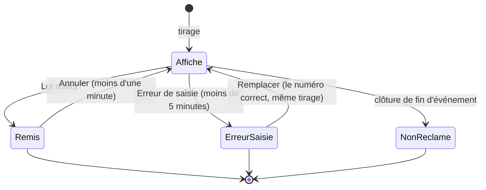

# Note de conception — Tombola

**Statut :** décisions actées avec Simon avant tout développement. Les trois
lots de la série sont livrés : le lot 1 (données, saisie des tirages, remise
des lots, page bénévole), le lot 2 (écran de salle, page publique, accueil,
correction d'une faute de frappe, statistiques et exports) et le lot 3
(saisie d'un tirage depuis la page « Annonce en salle », § 11).

À lire avec `docs/specification.md` §2 (« ne jamais bloquer ») et §9.1
(aucune donnée personnelle), `docs/conception-journal.md` (vocabulaire fermé)
et `docs/protocole-stress-test.md` (écritures concurrentes).

---

## 1. Le besoin

Pendant l'événement, une tombola tire environ cinq numéros gagnants par heure.
Les visiteurs viennent chercher leur lot au fil de la journée. Il faut :

- **afficher** les numéros gagnants encore en attente, là où le public les
  voit (écran de salle, page d'accueil, page publique) ;
- **retirer** un numéro de l'affichage quand son lot est remis ;
- **garder un historique** : numéros sortis, heure d'affichage, heure de
  remise, donc le délai entre les deux.

## 2. Décisions actées

1. **Un module désactivable « Tombola »**, avec les quatre états habituels
   (`app/modules.py`), **désactivé par défaut**. Une base existante ne voit
   rien changer.
2. **Numéros** : uniquement des entiers de **1 à 9999**.
3. **Deux façons de saisir un tirage**, sur la même page bénévole (la
   saisie manuelle a aussi un second point d'entrée depuis le lot 3, § 11) :
   - la **saisie manuelle** de 1 à 5 numéros tirés à la main, le cas normal ;
   - le **tirage par l'application**, en secours : on indique le plus grand
     numéro vendu, l'application tire 5 numéros au hasard parmi ceux de 1 à ce
     maximum qui ne sont pas déjà sortis pendant l'édition. Le tirage est
     **enregistré et affiché dès l'appui**. Il n'existe **aucun bouton pour le
     reprendre** : pouvoir refaire un tirage, c'est pouvoir choisir les
     gagnants.
4. **Tous les bénévoles** saisissent les tirages et remettent les lots.
5. **Remise d'un lot** : par le numéro présenté (un champ, puis **Lot
   remis**) ou par un bouton sur chaque numéro en attente. Une remise peut
   être **annulée pendant une minute** : le numéro revient à l'affichage.
6. **Édition** : la **clôture de fin d'événement termine la tombola**. Les
   numéros encore en attente passent en « non réclamé ». **Le premier tirage
   qui suit ouvre une nouvelle édition** : les numéros de l'année précédente
   peuvent ressortir, et l'historique les garde séparés.
7. **Aucune donnée personnelle** : des numéros et des heures, **aucun champ de
   texte libre**. On ne note jamais le nom d'un gagnant, ni la nature d'un
   lot : un champ « lot » ou « remarque » serait une porte (CLAUDE.md, « Règles
   métier »).

## 3. Arbitrages rendus au lot 1

| Question | Arbitrage | Pourquoi |
| --- | --- | --- |
| Champ `url` du module | `/tombola/gestion` au lot 1, `/tombola` depuis le lot 2 | Le champ est un **lien cliquable** de `/admin/fonctionnalites` ; `/tombola` y mènerait à une page introuvable tant que la page publique n'existe pas. |
| Corriger un numéro mal tapé | Bouton **Erreur de saisie** sur chaque numéro, pendant **5 minutes** après le tirage (`tombola.DELAI_ERREUR_SAISIE_S`) | Une faute de frappe se voit à la relecture du tirage. Un bouton toujours présent deviendrait un moyen d'effacer un gagnant sans trace claire. Le retrait est journalisé. |
| Après un envoi : redirection ou rendu direct | **Rendu direct** de la page | La saisie à corriger est réaffichée dans ses champs et le message nomme ce qui a été écarté, ce qu'une adresse ne porte pas. Le rechargement d'un envoi est inoffensif par construction (§5). |
| Module désactivé à la clôture | La clôture **termine la tombola dans tous les cas** | Une édition restée ouverte se rouvrirait l'année suivante avec les numéros de l'an passé. Sans effet sur une base qui n'a jamais tiré. |
| Nombre de non réclamés dans la ligne `cloture_prets` | **Non** | Il reste en base, durablement (motif `non_reclame`), là où les statistiques le liront ; et la ligne reste identique pour une association sans tombola. |
| Logique dans `services.py` ou à part | Module **`app/tombola.py`** | `services.py` dépasse cinq mille lignes ; la tombola a ses tables, son vocabulaire et ses constantes, et le lot 2 y ajoutera ses lectures. Patron de `app/carnet.py`. |
| Focus à l'ouverture | `autofocus` sur **Numéro présenté** à l'ouverture et après une remise, pas après un tirage | Le geste répété de la journée est la remise ; après un tirage, on veut relire les numéros. |

## 4. Modèle de données (base de prêt)

Trois tables, dans l'ordre des clés étrangères, toutes en `AUTOINCREMENT` : un
bouton resté ouvert porte l'identifiant d'une ligne, qui ne doit jamais
désigner une autre ligne (leçon du lot annonce-2).

```text
tombola_editions  id, ouverte_le, close_le (NULL = ouverte)
tombola_tirages   id, edition_id → editions, tire_le, mode (manuel | aleatoire),
                  numero_max (aléatoire seulement), jeton_formulaire UNIQUE
tombola_numeros   id, tirage_id → tirages, edition_id → editions (recopié),
                  numero (1 à 9999), affiche_le, sorti_le,
                  motif (NULL | remis | erreur_saisie | non_reclame),
                  remplace_id → tombola_numeros (lot 2, NULL sauf correction)
```

**Le réglage** `tombola_numero_max` (table `parametres`) retient le plus
grand numéro vendu d'un tirage par l'application à l'autre. Aucune valeur par
défaut n'est écrite en base.

**La vie d'un numéro** :



**Deux filets d'unicité**, rangés avec ceux des prêts
(`models.SCHEMA_INDEXES_UNIQUES`, créés par `db._creer_index_uniques`, qui
avertit sans empêcher le démarrage) :

- `idx_tombola_numero_unique` : un numéro ne sort qu'une fois par édition,
  **sauf** en `erreur_saisie`, pour qu'un numéro mal tapé puis retiré puisse
  être ressaisi correctement ;
- `idx_tombola_une_edition_ouverte` : une seule édition sans `close_le`.

Un troisième, au lot 2 : `idx_tombola_un_remplacement` (`remplace_id` unique
quand il est renseigné) — une ligne retirée pour erreur de saisie n'est
remplacée qu'une fois (§9).

La vraie protection reste la transaction (§5) ; les index rendent visible un
chemin d'écriture qui nous échapperait.

**Migrations** : trois tables neuves, donc un simple `CREATE TABLE IF NOT
EXISTS` ; la colonne `remplace_id` du lot 2 est aussi ajoutée par
`db._MIGRATIONS_COLONNES`, pour les bases d'essai qui avaient déjà la table
du lot 1. Une base d'avant ne reçoit que des tables vides ; la restauration
d'une archive antérieure repasse par `init_db` (`sauvegarde`) et les crée.

**Sauvegarde** : les tables partent dans les archives comme les prêts. Il n'y
a aucun texte libre, donc rien à retirer.

## 5. Écritures concurrentes et double appui

**Le constat de la 1.32** : deux envois simultanés du même formulaire
d'annonce avaient produit deux lignes. Ici, un double appui sur **Tirer 5
numéros** tirerait dix numéros au lieu de cinq, et l'erreur ne se
rattraperait pas.

- Chaque formulaire de tirage porte un **jeton de formulaire** aléatoire,
  renouvelé à chaque affichage de la page, en champ caché. **Deux jetons
  distincts** par page, un par formulaire : un jeton partagé ferait d'un
  tirage aléatoire envoyé après un tirage manuel le « double appui » du
  premier. Le tirage stocke le jeton sous contrainte d'unicité ; un second
  envoi avec le même jeton ne crée rien et réaffiche le résultat du premier.
- Tout le tirage — ouverture de l'édition s'il n'y en a pas, lecture des
  numéros sortis, tirage, insertion, réglage du maximum — tient dans **une
  seule transaction** (`services.transaction`, `BEGIN IMMEDIATE`). Deux
  premiers tirages simultanés n'ouvrent qu'une édition ; deux tirages
  simultanés du même numéro n'en laissent passer qu'un, l'autre écarté avec
  son message.
- Une **remise** relit la ligne sous le verrou : la seconde d'un double appui
  tombe dans « déjà remis » et ne réécrit pas `sorti_le`. L'**annulation** et
  le **retrait pour erreur** visent l'identifiant de la ligne, pas le numéro.
- Le tirage par l'application utilise `secrets.SystemRandom().sample`,
  jamais le module `random`. Le générateur est injectable pour les tests.

## 6. Messages — chaque cas a le sien, aucun n'est une erreur

| Cas | Message |
| --- | --- |
| Numéro en attente remis | « Lot remis : numéro 45. » + **Annuler** |
| Numéro déjà remis | « Le lot du numéro 45 a déjà été remis à 15:12. » (+ **Annuler** dans la minute) |
| Numéro jamais tiré dans l'édition | « Le numéro 45 n'a pas été tiré. » |
| Numéro retiré pour erreur de saisie | « Le numéro 45 a été retiré : erreur de saisie. » |
| Saisie illisible ou hors bornes | « Tapez un numéro entre 1 et 9999. » |
| Tirage manuel, numéro écarté | « « 45 » écarté : déjà sorti pendant cette tombola. » (ou « tapé deux fois dans ce tirage », « ce n'est pas un numéro entre 1 et 9999 ») |
| Tirage manuel sans numéro valide | « Aucun numéro affiché : corrigez la saisie, puis envoyez-la à nouveau. » — saisie réaffichée, rien d'écrit |
| Tirage aléatoire, moins de 5 possibles | « Il ne restait que 3 numéros possibles entre 1 et 120 : … » |
| Tirage aléatoire, plus aucun possible | « Tous les numéros de 1 à 120 sont déjà sortis : rien n'a été tiré. … » |
| Formulaire envoyé deux fois | « Numéros affichés : … Le formulaire est parti deux fois : un seul tirage a été enregistré. » |

Les phrases ont un seul domicile : les fonctions `message_*` de
`app/tombola.py`.

## 7. Clôture, formation, journal

- **Clôture de fin d'événement** (`services.cloturer_evenement`) : dans la
  même transaction que les prêts et les annonces, l'édition ouverte reçoit
  `close_le` et ses numéros encore affichés passent en `non_reclame` avec
  `sorti_le` = l'heure de la clôture. **Ce `sorti_le` n'est pas un délai de
  remise.** Le message de clôture nomme les numéros non réclamés, seulement
  s'il y en a ; la confirmation nomme la tombola seulement si le module n'est
  pas désactivé.
- **Réinitialisation du site de formation** : les trois tables (numéros,
  tirages, éditions) et le réglage du plus grand numéro sont vidés
  (`tombola.vider`).
- **Journal** : module `tombola`, cinq actions (`tombola_tirage`,
  `tombola_lot_remis`, `tombola_remise_annulee`, `tombola_erreur_saisie`,
  et au lot 2 `tombola_numero_remplace`).
  Les numéros y figurent : ils ne désignent personne. Un geste sans effet
  (double remise, jeton rejoué, annulation tardive) n'écrit rien. Détail :
  `docs/conception-journal.md`.

## 8. Ce que voit le public (lot 2)

**Une seule lecture** : `tombola.numeros_affiches`, sœur publique de
`numeros_en_attente`. Elle renvoie, pour l'édition ouverte, `{tirage_id,
heure, numeros: [int], nouveau}` par tirage, le plus récent d'abord — **sans
aucun identifiant de ligne ni drapeau de gestion**. Trois lecteurs : l'écran
de salle, la page `/tombola`, l'accueil. Lecture seule, relue toutes les dix
secondes par `/live/data`.

| Question | Arbitrage | Pourquoi |
| --- | --- | --- |
| Clé de défilement | `tirage_id` | Patron des annonces ; ce n'est pas une donnée sensible. |
| Ordre | Récent d'abord sur l'accueil et `/tombola` ; **ancien d'abord** dans `/live/data` | Le défilement suit l'ordre des tirages, un nouveau tirage rejoint la fin du tour — et la page **saute dessus** dès qu'il apparaît. |
| Emplacement sur `/live` | **Troisième bloc de la zone basse** (option a) | Mesuré : la zone basse (405 × 397 px à 1280 × 720) affiche cinq numéros à quatre chiffres en 59 px sans troncature ; la zone haute (un tiers de la hauteur) n'en aurait permis qu'une fraction. Contrepartie mesurée et corrigée : tournois et animations n'ont plus qu'un tiers de la largeur, la jauge passe alors sous le nom (classe `avec-tombola`, posée seulement quand le panneau est affiché). |
| Durée d'une page | **12 s**, `live.DUREE_PAGE_TOMBOLA_S`, constante sœur | Une annonce se lit ; un tirage se **cherche** (on compare cinq numéros à son ticket). |
| Marque « Nouveau » | **5 minutes**, `tombola.DUREE_NOUVEAU_TIRAGE_S`, calculée par le **serveur** | L'horloge du poste de projection n'entre pas en jeu. Un mot, pas une couleur seule. |
| Taille des numéros | Très grands, puis **réduits par paliers en JS** si un tirage ne tient pas | Un numéro coupé est le défaut à éviter : un gagnant qui ne lit pas son numéro ne vient pas chercher son lot. |
| Page admin restée ouverte avant la mise à jour | **Marqueur caché** `panneaux_v=2` (option a) | Les cases se lisent par présence : sans marqueur, une case `tombola` absente garde sa valeur au lieu d'être décochée. |
| Rafraîchir `/tombola` | Un lien **Actualiser** et l'heure de mise à jour, **pas** de `meta refresh` | WCAG 2.2.1 : un rechargement automatique fait perdre sa position à un lecteur d'écran. |
| Accueil : combien de numéros | **Tous** | Mesuré à 375 × 667 : 30 numéros en 7 tirages font un bloc de 849 px. Couper aux deux derniers tirages ferait croire à un visiteur que son numéro n'est pas sorti. |
| Accueil : pour qui | `module_visible` (fiche A3) | Pour un visiteur, le bloc n'apparaît qu'en état « tous ». En « discret », `/tombola` répond mais l'accueil ne la montre pas. |

**Panneau de l'écran de salle** : cinquième entrée de
`live.CLES_PANNEAUX`, cochée par défaut, éteinte seulement par l'état
« désactivé » du module (règle de projection : les états « bénévoles » et
« discret » le laissent allumé). Il n'apparaît **que** s'il reste des numéros
à retirer : sans tombola, l'écran est identique au pixel près (mesuré). Il ne
touche jamais le bandeau des annonces ni l'alerte tournoi (D8).

## 9. Corriger une faute de frappe dans le tirage d'origine (lot 2)

Au lot 1, « 87 » retiré pour erreur de saisie puis « 78 » ressaisi devenait un
**nouveau tirage** d'un numéro, à une autre heure : deux pages sur l'écran,
deux lignes dans les statistiques. Arbitrage (a) : **remplacer dans le tirage
d'origine**.

- Le message du bouton **Erreur de saisie** porte un champ **Numéro correct**
  et un bouton **Remplacer**. Le numéro correct entre **dans le même tirage**,
  avec `affiche_le` = maintenant — l'instant où le gagnant peut le lire, qui
  compte pour le délai de remise.
- **Fenêtre** : `DELAI_ERREUR_SAISIE_S` **après le retrait** (écart au
  prompt, qui disait « pendant la fenêtre de l'erreur de saisie ») : comptée
  depuis l'affichage d'origine, un retrait fait à 4 min 50 ne laisserait que
  dix secondes pour taper le bon numéro.
- **Double appui** : **au plus un remplacement par ligne retirée**
  (`remplace_id`, index unique partiel), plutôt qu'un jeton de formulaire.
  Un jeton aurait demandé une colonne lui aussi ; la donnée protège en plus
  contre deux bénévoles qui corrigent la même faute, et dit après coup quel
  numéro a corrigé lequel. Un second envoi du même numéro est un rejeu
  (message de succès, rien d'écrit).
- Un numéro déjà sorti est refusé ; sans saisie, rien ne se passe ; le
  formulaire revient tant que la correction reste possible.
- **Journal** : action propre `tombola_numero_remplace`, `objet` =
  « 87 → 78 », `ref` = le numéro affiché. Pas un `tombola_tirage` de plus :
  ce n'est pas un tirage.

## 10. Statistiques et exports (lot 2)

`tombola.statistiques(conn, debut_utc, fin_utc)` ; c'est la **route** qui la
lit, seulement si `module_visible`, et la transmet aux exports (comme la
couleur). Section absente sans tirage dans la période.

- **Période** : sur `tombola_tirages.tire_le` ; un numéro compte dans la
  période de son tirage.
- **Compteurs** : tirés (hors erreurs de saisie), remis, encore affichés, non
  réclamés ; erreurs de saisie **à part**, hors de tous les autres chiffres.
- **Délai médian de remise** : `statistics.median` sur `sorti_le −
  affiche_le` des seuls `remis`, formaté par `services.format_duree` ; « — »
  sans aucun remis. **Jamais** les `non_reclame`. Un délai **négatif**
  (horloge du serveur revenue en arrière) est **écarté et compté** : le
  ramener à zéro tirerait la médiane vers le bas sans rien dire.
- **Par tirage**, **par mode** ; **par session de tombola** (une ligne de
  `tombola_editions`) seulement quand la période en couvre au moins deux
  (sinon le tableau répéterait la synthèse). Titre « Par session de tombola »
  depuis le lot bilan-3 : une « édition » y désigne désormais une période de
  l'événement datée par le bureau (`editions_evenement`), sans lien avec les
  sessions de la tombola.
- **Excel** : feuille « Tombola », cellules écrites par `ecrire_cellule`.
  **PDF** : section cochable `tombola`, cochée par défaut seulement quand
  elle existe ; la case n'apparaît sur la page qu'à la même condition.

## 11. Second point d'entrée : la page « Annonce en salle » (lot 3)

Au stand, c'est souvent le même bénévole qui pose les annonces et saisit les
numéros tirés. La page `/live/annonce` porte donc, sous les annonces, un bloc
**Tombola** : le message du dernier tirage, les cinq cases et **Afficher les
numéros**, les numéros encore affichés en salle en **lecture seule**, et un
lien **Gérer la tombola**.

**Il ne fait que la saisie à la main.** La remise, son annulation, l'erreur
de saisie, le remplacement et le tirage par l'application restent sur
`/tombola/gestion` : ce sont des gestes de la page de la tombola, qui ont
leurs délais et leurs boutons répétés ; les dupliquer ferait deux pages à
tenir alignées pour un gain nul (on n'y remet pas de lot).

| Point | Choix | Motif |
| --- | --- | --- |
| Un seul domicile | Fragment `_tombola_saisie.html` (deux macros : le message, le formulaire) ; côté route `routes/tombola.py::enregistrer_tirage_manuel` (saisie + journal) et `saisies_a_reafficher` | Une règle de saisie, de réaffichage ou de journal ne peut pas diverger d'une page à l'autre. La fonction vit dans une route parce qu'elle journalise (`docs/conception-journal.md` § 5.2). `routes/live.py` l'importe ; l'inverse n'existe pas (aucun cycle). |
| Gardes de `POST /live/annonce/tombola` | Le jeton, **et** `module_visible(request, "tombola")` vérifié à la main | Le routeur `live` est derrière `garde_module("live")` : la garde du module tombola ne s'y applique pas. Module désactivé : rien d'écrit, rien au journal, retour 303 à la page. |
| Interrupteur des annonces | **Sans effet** sur le bloc | Deux droits distincts. Interrupteur fermé, la page garde son explication (reformulée : « vous ne pouvez pas poser d'annonce ») et le bloc vient dessous. Le lien **Annonce en salle** du menu suit, lui, l'interrupteur. |
| Module masqué | Bloc absent, données non lues | La page est alors identique, à l'octet près, à celle d'avant le lot (vérifié par comparaison du HTML rendu). |
| Bouton | **Secondaire** | **Ajouter une annonce** reste le seul bouton principal de la page (`docs/ui-composants.md` § 1). |
| Retour au bloc | Le formulaire vise `…/tombola#tombola`, rendu direct | Le navigateur garde l'ancre : le résultat s'affiche sans remonter, sans JS. `scroll-margin-top` sur le titre, que le bandeau collant cachait. |
| Identifiants | Cases `tombola-numero-1` … sur la page Annonce, `numero-1` … sur la page de la tombola | Paramètre `prefixe` du formulaire : les `id` restent uniques quelle que soit la page. |
